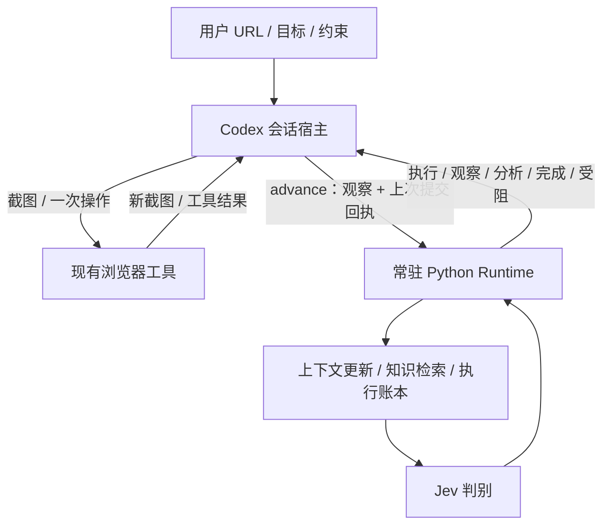

# 双模型游戏 Agent 迭代架构

状态：架构提案，尚未开发或验证部署。2026-10-12。协作依据：[design.md](design.md)。

实施更新：上面的状态描述保留提案制定时的边界。当前 P0/P1/P2 已验收；P2（0.3.0）已完成上下文与知识实现，109 项测试、独立 stdio、真实 Jev 请求和桌面宿主验证通过。详情见 [P1 验收](p1-acceptance.md)、[P2 验收](p2-acceptance.md) 与 [P2 契约](p2-contracts.md)。决策适配接口采用 decide(DecisionRequest) → DecisionAnswer；原 evaluate(TextCase, index) 仅保留作 P0 探针兼容。P3 宿主流程迁移尚未实施。

## 1. 架构决策

采用 **Codex 会话宿主 + 本地常驻 Python 决策服务 + Jev**。服务通过本地 stdio MCP 提供结构化工具；浏览器继续由现有受支持的 computer-use/browser 工具操作。用户提供 URL、目标和约束后，宿主在活动会话内持续运行到完成、受阻或中断。

Codex 提供视觉理解与必要的工具调度；Jev 拥有正常行动选择权；服务拥有运行状态、上下文和决策生命周期。程序根据状态规定下一步需要观察、执行还是分析，Codex 按返回任务提供能力，不再自行编排状态文件。

这是一套依赖活动 Codex 会话的自主 Agent。首版仍需要主模型处理新截图并调用 UI 工具，不具备关闭会话后的后台持续游戏能力。常驻服务不假装能主动唤醒主模型。后续如需要独立宿主，必须取得受支持的模型调用和浏览器能力，再复用核心服务；不预先引入额外模型 API、第二浏览器或训练视觉模型。

MCP 解决稳定工具入口和结构化通信；不会自动降低视觉推理成本，也不保证服务联网权限。当前架构是待验证的选型，不能以文档代替实际连通性验收。

## 2. 组件和所有权

### 会话宿主与能力适配

- 绑定并复用同一页面，取得截图及有效的页面身份。
- 常规观察一次生成事实、未知项、变化、候选和上次动作验证。禁止推荐动作或策略排序。
- 按服务返回的候选调用一次 UI 工具；执行参数和操作语义已经属于该候选，不由 Codex重新决定对象。
- 工具拒绝时报告实际失败；不擅自改成另一种动作。取得新截图后提交下一轮。
- 服务要求分析时，补充指定问题的解释、对象定位或候选，然后交回服务。宿主仍须遵守平台工具和权限要求。

### Runtime

- 单运行串行状态机，单个待执行动作，单个在途 Jev 请求。
- 自动生成 ID、时间、上下文版本、候选映射、差额和重复计数。
- 更新状态、核验未完成动作、构造判别输入、调用决策客户端、检查返回选项、输出下一步任务。
- 自动保存所有请求、回答、提交回执和验证；在关键事件导出兼容 checkpoint。
- 确定性错误暂停执行；不隐藏策略规则以替代 Jev。

### 决策客户端

使用官方 TypeSafe Python SDK 的长生命周期异步客户端，运行启动时建立，服务结束时关闭。请求用文字 state 与 Choice；默认一次选择完整动作。独立判别可以同批，有依赖才分次。

对外只有 evaluate(context, questions) → typed answers，不向宿主暴露 HTTP 操作。保留实际模型、概率、confidence、耗时与用量。模型配置默认 jev-latest，运行记录实际响应模型；正式对比时锁定已验证可用的版本，避免别名变化混淆结果。

### 存储与知识

SQLite 保存运行、观察、候选、决策、执行事件及上下文版本，是唯一运行事实来源。数据库位于 run/<run-id>/；state.json、bugs.json 是兼容导出，不能同时作为第二套可独立修改的状态源。

知识 Markdown 继续按游戏隔离、可独立阅读；索引可重建。Codex 提供带依据的知识草案，服务校验引用并按维护规则保存。存在语义冲突时请求分析，程序不自动宣布两种结论谁正确。

## 3. 交互接口

首版公开五个工具，不提供 prepared/submitted/verified 文件命令：

- **start**：输入 URL、游戏身份或待识别标记、目标、完成条件、约束；返回 run_id、任务概要、需要绑定页面和获取观察的要求。启动包含服务自检，失败则阻止进入决策流程。
- **advance**：输入 run_id、幂等 submission_id、当前观察包，以及上次 decision_id 对应的工具提交回执和视觉结果（若存在）。一次完成验证、更新、检索、Jev 判别和持久化，返回一个下一步任务。
- **resume**：读取已有运行，返回当前目标、待验证动作与新截图要求；不沿用旧坐标执行。
- **status**：只读查看状态、进度、问题和性能摘要。
- **finish**：记录主动结束、用户取消或阻塞说明，保存最后已知回执与知识草案并生成报告；目标完成可由 advance 自动完成，无需额外调用。

advance 返回任务为 EXECUTE、OBSERVE、ANALYZE、COMPLETE 或 BLOCKED。EXECUTE 包含 decision_id、来源观察、候选 ID、操作种类与本地执行参数；OBSERVE 包含等待边界；ANALYZE 包含有限帮助类别、缺失信息与证据。COMPLETE 必须附已记录的目标证据。

宿主只传本轮新信息，服务补齐目标、历史、知识与请求问题。所有接口都直接传对象，不要求宿主创建输入文件。工具输出显示实际选择与来源，不生成虚构的 Jev 思考过程。

观察包最小字段：页面/截图引用、事实、未知项、可见对象、候选、上一动作视觉结果、异常线索。截图引用可以是平台引用，不强制本地文件存在；不可归档时如实记录。服务生成内部观察 ID；不能要求 Codex手工生成每个事实的时间和唯一标识。

候选包含完整对象操作、当前执行绑定、必要前提及已知效果。坐标绑定当前截图；同一页面布局变化也需刷新。用户约束通过显式标签进行确定性检查；模糊授权不能依靠字符串过滤假装已解决，需补充理解或暂停。

## 4. 状态机与故障恢复

主流程：NEED_OBSERVATION → DECIDING → AWAITING_EXECUTION → NEED_VERIFICATION → 下一轮或 COMPLETE。

宿主收到 EXECUTE 后调用工具，随后新截图与回执在下一次 advance 合并提交。服务在返回 EXECUTE 前保存待执行意图；下一次提交时才记录实际提交及验证。数据库不会凭“已下发”宣布动作执行成功。

若期间中断，待执行状态为未知。resume 必须取得新截图并核对，不能默认重发动作。确实无法从画面判断是否执行时，标记结果未知，请求分析或报告阻塞；不盲目重复领取、消费或战斗。

相同 submission_id 的重复 advance 返回已保存结果，不重复调用 Jev。新观察使旧动作失效；迟到的回答记录但不执行。服务重启后从账本恢复，失效浏览器句柄须由宿主重新绑定。

等待是带时长的动作选择，结束后需要新截图。默认提供短等待选项，最长单次 5 秒，不建立固定帧率循环。连续无进展默认 3 轮触发 ANALYZE；已验证无响应 2 次先核验定位和可用控制台，记录实际原因。

低 confidence 不统一进入失败：可逆且多个候选都合理时允许所选行动；关键条件未知时补充观察；候选不足时分析。初期记录分布与处理结果，通过回放确定阈值，未校准前不宣称置信度等于可靠性。

Jev 服务故障默认 BLOCKED；不静默改为主模型决策。Codex 接管是明确的可配置运行策略，默认关闭，启用时每个动作记录来源及原因。

## 5. 上下文管理

Runtime 自动维护任务、当前局面、执行反馈、游戏知识四部分。新的可见事实覆盖旧页面事实；跨页的信息保留为历史已知，未知不能自动补成否定。

每次输入包含任务、当前局面、相关规则、最近 6 条已验证结果以及仍有效的阻塞。失败摘要按语义目标关联，不按坐标关联；成功恢复会解除对应阻塞。

首次识别游戏或新机制时请求 Codex 生成规则含义与相关知识检索线索。正常轮次依据页面和候选自动检索，不让 Codex读完整知识库再拼请求。字段名称与判别指令默认英文，游戏原文标签保留；Codex 在必要时一次补充语义，不逐轮翻译稳定标签。

输入预算先以序列化文字长度限制，默认 12,000 字符；这不是 token 限制。保留任务、约束、当前证据、未知项和候选，先裁剪无关知识与旧成功记录。必要内容仍超预算时返回 ANALYZE 请求拆分当前判断，不能静默截断。

阶段方向只在 Jev 选择后保存。页面变化并不自动重选方向；完成、前提失效或受阻才刷新。服务不会将 Codex 生成的候选顺序当作策略优先级。

## 6. 联网、审批与部署

固定服务入口接收 TYPESAFE_API_KEY，凭据仅在服务内部使用。通过宿主支持的环境变量传递设置配置，不将 key 放进工具参数、模型输入或日志。配置安装是单独步骤，不能在开发文档中假定已成功。

连接超时初始 5 秒，暂时网络错误、限流或 5xx 最多重试一次；认证和请求格式错误立即返回明确错误。重试受 12 秒整体预算约束，Retry-After 超出预算时报告稍后可恢复，不叠加 SDK 与业务重试。

部署验收首先执行连续 10 次真实文本判别：同一 MCP 服务、同一固定入口、无逐次审批、无每次先在沙箱失败的路径。区分进程启动授权、MCP 工具授权和实际出站网络权限；宿主管理策略禁止时如实受阻。MCP 不用于绕过网络策略。

未通过连通性验收不进入游戏测试。仅“手动终端外成功”或“SDK 写法正确”均不能证明会话中的实际入口可用。固定命令备选也必须达到同一验收，不重新采用逐步 JSON 文件流程。

## 7. 迭代顺序与准入条件

**第一步：验证能力边界。** 建立最小服务探针，验证 MCP 注册、结构化传参、key 环境、10 次联网、当前 UI 工具操作绑定方式。此步骤需要后续开发授权；本轮只设计。任何失败先修复入口，不扩展游戏逻辑。

**第二步：核心 Runtime。** 完成状态机、advance、SQLite、上下文检索、Jev 客户端、幂等与恢复。模拟回答验证控制流；历史记录中缺失截图的场景标注为重建或模拟。

**第三步：会话闭环。** 迭代 skill 和 AGENTS，取消每轮 Codex 手写决策及 checkpoint；规定观察输出与直接执行返回任务。先完成一个截图驱动任务，再验证一次迷塔挑战和建筑重新定位。

**第四步：质量与性能。** 比较纯 Codex 与双模型的总耗时、观察/判别/工具耗时、输入量、目标完成情况、无效操作和接管率。不同账号状态导致的差异单独注明。已有一个 URL 足够首轮验收，跨游戏能力在取得第二游戏后验证。

测试必须覆盖：未知页面、多个有效候选、资源不足、定位错误、自动战斗等待、页面切换、奖励状态变化、目标停止、旧观察失效、重复 advance、操作后中断、服务重启、知识冲突、Jev 暂时故障和授权失败。网络重试不能导致 UI 操作重放。

未来替换 Decisions 仅新增决策客户端；若直接传图会改变观察职责和上下文形态，须另行验证，不能预先宣称只是换模型名字。

## 8. 本次设计明确回答

1. **谁更新上下文？** Runtime 自动更新；Codex 提供画面语义和必要解释。
2. **谁决定下一轮开始？** Runtime 状态机给出下一任务；活动会话宿主根据执行结束或等待结束继续调度。
3. **谁生成 Jev 请求？** Runtime 的上下文构建器和客户端。
4. **谁保存决策历史？** Runtime 自动写执行账本，并导出兼容记录。
5. **谁判断需要主模型？** 每张新图都需要常规视觉理解；复杂分析由 Jev 帮助选项或确定性故障/无进展规则触发。服务不自行调用不可访问的主模型。

## 官方依据与验证边界

- [Codex MCP](https://developers.openai.com/codex/mcp)：工具通信、stdio 服务与环境传递；具体桌面部署仍须实测。
- [配置参考](https://developers.openai.com/codex/config-reference)：MCP 设置与工具审批。实际受管理策略约束，不保证所有设置可修改。
- [TypeSafe Python SDK](https://docs.typesafe.ai/sdk/python)、[State](https://docs.typesafe.ai/concepts/state)、[Confidence](https://docs.typesafe.ai/confidence)：调用与判别语义。

本轮没有注册 MCP、修改用户权限、调用 Jev 或操作游戏。上述默认值是待测试的架构选择，不是已观测性能。
